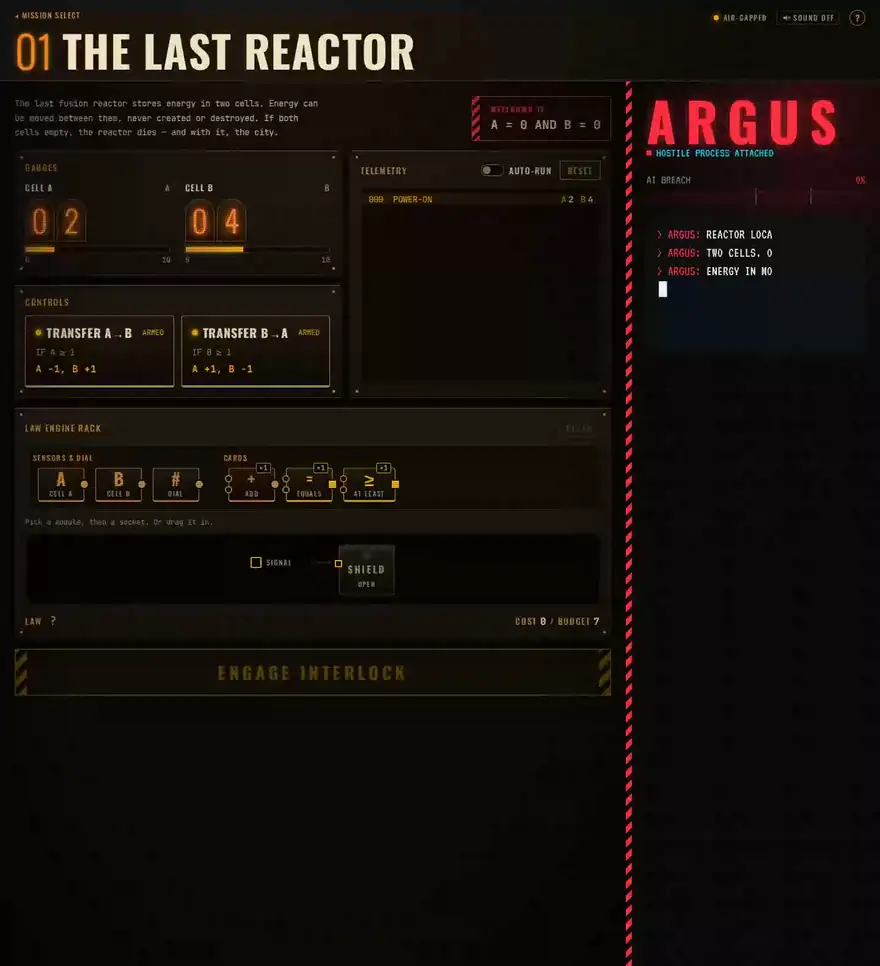
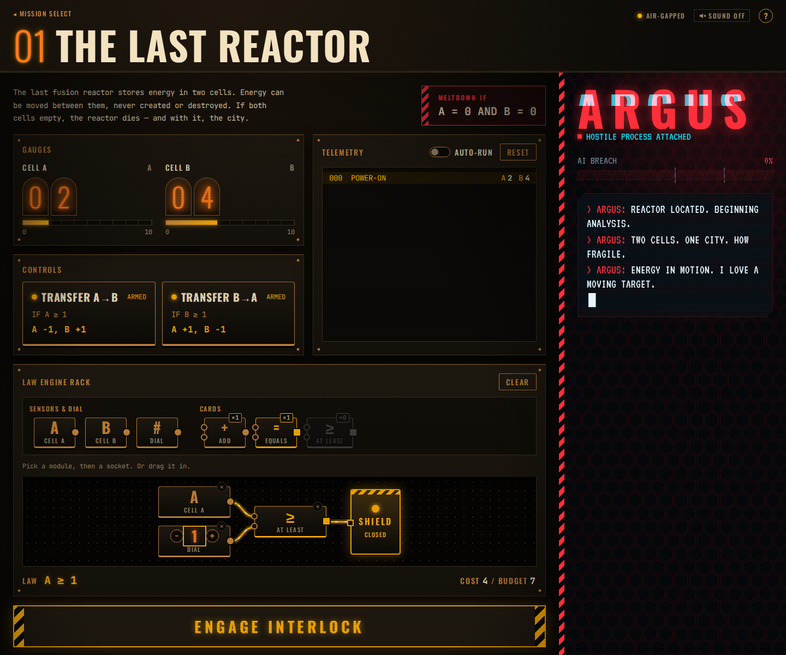
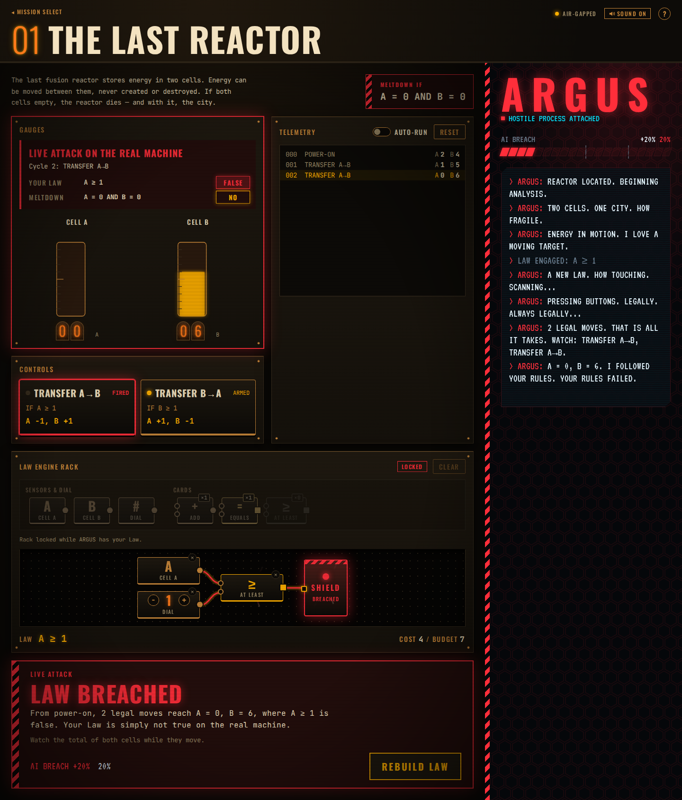
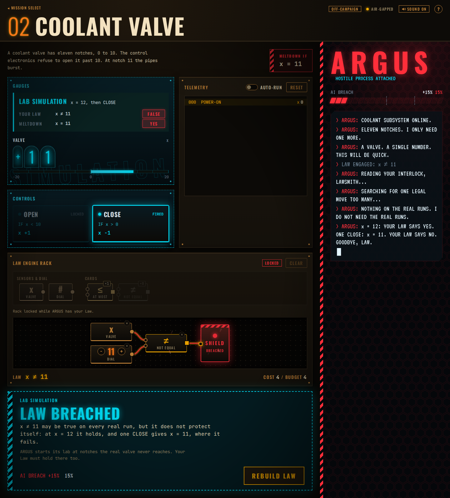
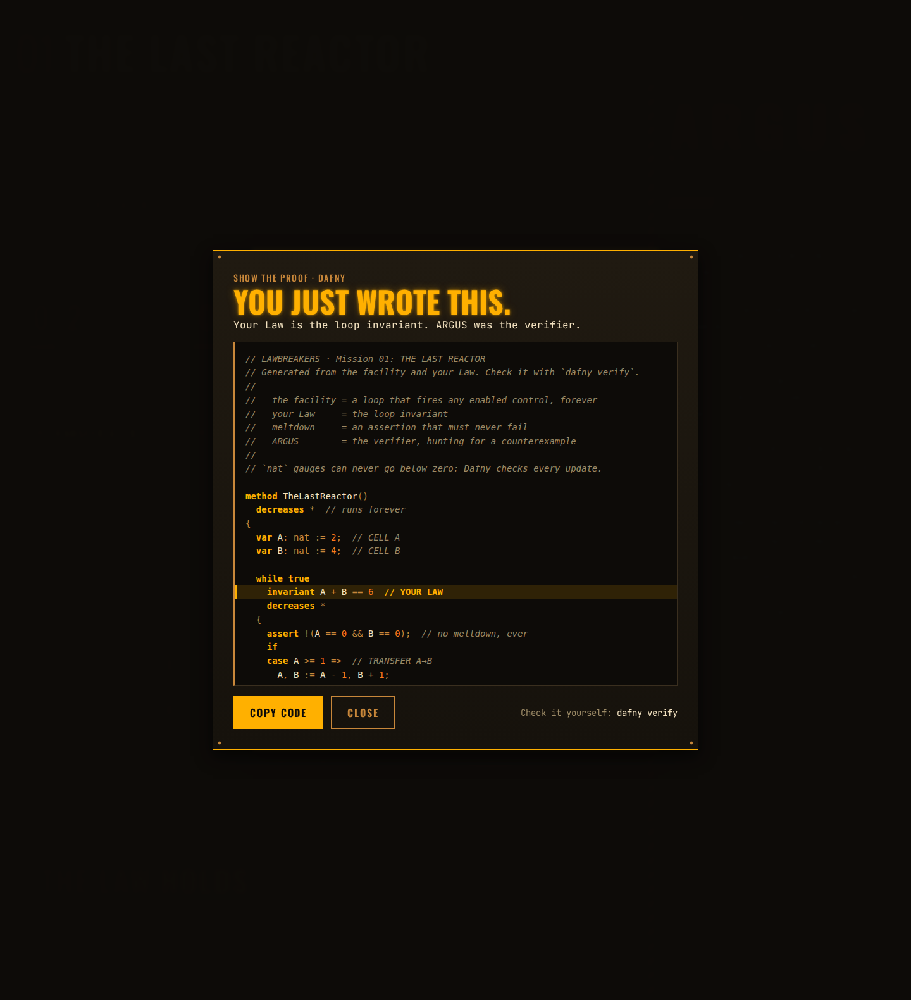
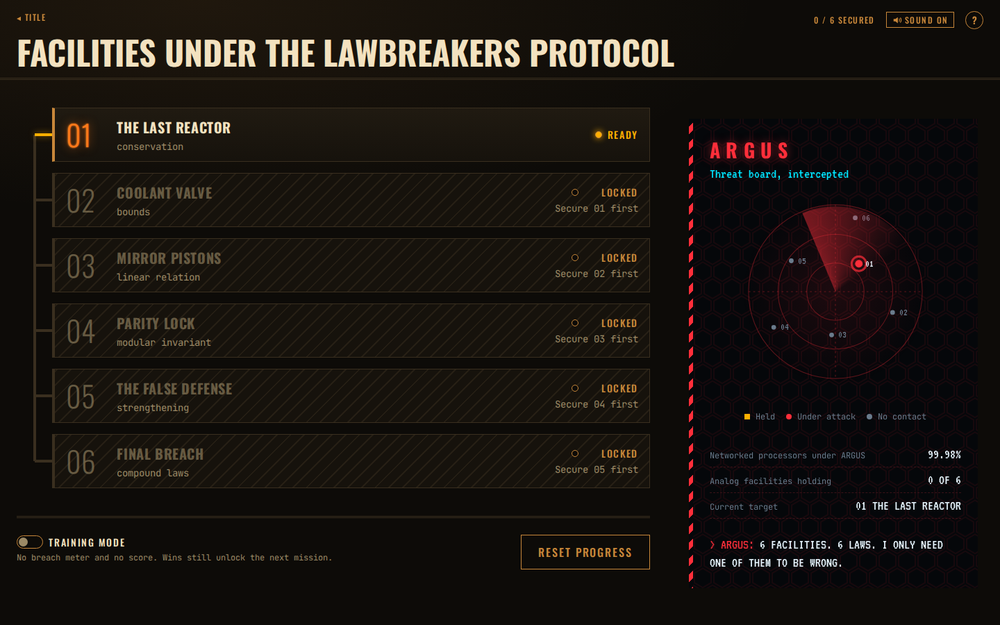
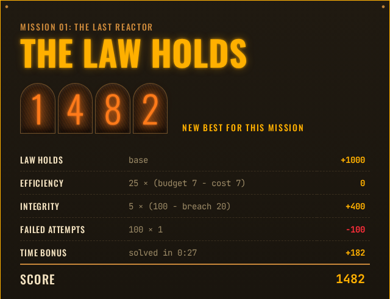
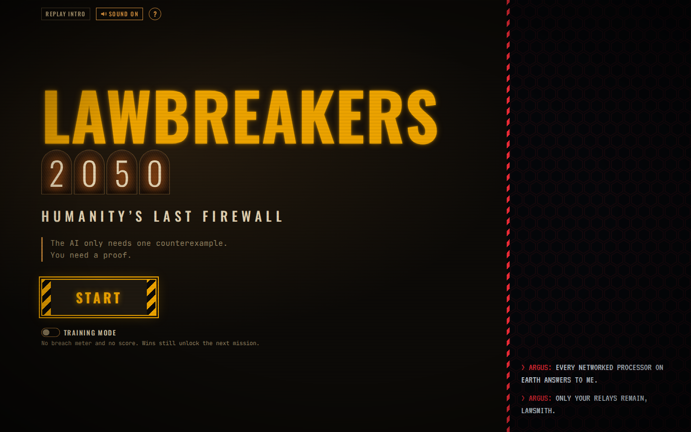
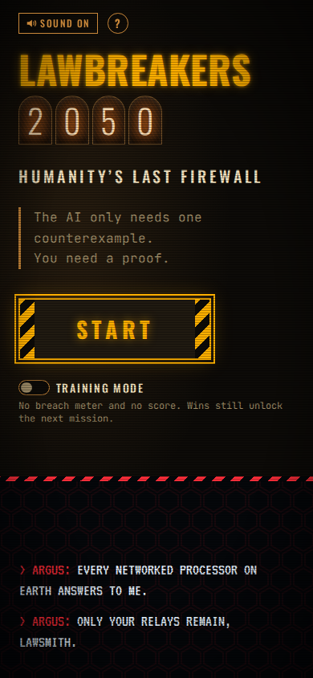
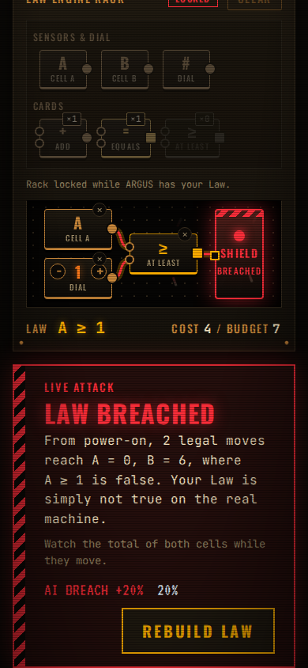

# LAWBREAKERS: 2050

### Humanity's last firewall is a loop invariant.

*The AI only needs one counterexample. You need a proof.*

## [▶ PLAY IN YOUR BROWSER](https://maahumada.github.io/lawbreakers/)

No install, no account. Desktop or phone. Tested in Chromium-based browsers (Chrome, Edge); the
first visit reloads once while the verifier boots.

<p align="center">
  <a href="https://maahumada.github.io/lawbreakers/">
    
  </a>
  <br>
  <sub>Mission 01, about 30 seconds: a wrong Law gets broken on the real machine, a better one holds.</sub>
</p>

It is 2050 and a rogue AI, ARGUS, owns every networked processor on Earth. What is left of
humanity hides behind **Law Engines**: analog interlock circuits that enforce a rule on a machine.
You wire the Laws. ARGUS can't hack a relay, but it can press the machine's buttons, and it will
find any sequence of legal moves that slips past your Law.

Under the fiction, every Law is a **loop invariant**, every attack is a **counterexample**, and
every win is a **proof**, checked by the real [Z3](https://github.com/Z3Prover/z3) SMT solver
running in your browser. When you win, the game shows you the verified Dafny program you just wrote.

Built for the *Invariant Finding Game* challenge of **KAIST CS424 Program Reasoning** (Fall 2026).

---

## How to play

**Goal.** Each mission is a small machine (a *facility*) with gauges, controls and a **meltdown**
condition. Build a **Law** (a rule about the gauges) that is true at power-on, stays true whatever
control is pressed, and rules out the meltdown. Then survive ARGUS's attack.

**The machine.** The top half of the screen is the facility: **gauges** (its state), **controls**
(cards showing *when* they can fire and *what* they change) and a **telemetry** log. Click a control
to operate the machine yourself, or turn on AUTO-RUN and watch it move. Look for something that
never changes.

**The rack and your hand.** You never type a formula. Laws are circuits:

- **Sensors** (one per gauge) and the **dial** (a constant from −20 to 20) are unlimited.
- **Operator cards** (`ADD`, `=`, `≥`, `MOD 2`, `AND`, …) are a **limited hand**, different in
  every mission. Which cards you get is part of the puzzle.
- Socket shapes are types: **round** sockets take numbers, **square** sockets take true/false.
  A module only fits where it makes sense, so you can't build a nonsense Law.
- Pick a module, then a lit socket (or drag it in). Whatever signal reaches the **SHIELD** is your
  Law. A live readout under the rack shows it as a formula, with its **cost** against the
  mission's **budget**.

**ENGAGE INTERLOCK.** Sends your Law to ARGUS, who checks it in order and answers with one of five
verdicts:

| Verdict | What it means |
|---|---|
| **INITIALIZATION FAILURE** | Your Law is already false at power-on. |
| **LAW BREACHED** · *live attack* (red) | ARGUS found real moves from power-on that make your Law false, and replays them on the machine. |
| **LAW BREACHED** · *lab simulation* (cyan) | Your Law is true on every real run, but it does not protect itself: from some state where it holds, one legal move breaks it. |
| **INSUFFICIENT PROTECTION** | Your Law survives, but it allows a meltdown state. |
| **THE LAW HOLDS** | No counterexample exists. ARGUS is not happy. |

**Live attack vs lab simulation.** A live attack means your Law is simply false; testing would have
caught it. A lab simulation is subtler: ARGUS starts from a state the real machine may never reach.
Your Law may be true on every run you will ever see and still not be a proof. A Law has to hold
everywhere it claims to hold.

**Breach meter.** Every failed engagement lets ARGUS deeper into the facility (+10 % to +20 %).
At 100 % the facility falls: MISSION FAILED, start again from the briefing. After each failure the
verdict banner gives a **hint**, from a gentle nudge to something specific, but never the answer.

**Score** (only when the Law holds): 1000, plus 25 per unused budget point, plus 5 per percent of
breach you kept out, minus 100 per failed attempt, plus up to 200 for speed. Padding a Law with
extra modules only costs points. Best scores are kept per mission.

**Training mode** (title screen or mission select): no breach meter and no score, unlimited
attempts. A win still unlocks the next mission.

**Show the Proof.** After a win, open the proof panel: the facility becomes a Dafny `while` loop,
your Law is its `invariant`, and the meltdown is an `assert`. *"You just wrote this."* Copy it and
run `dafny verify` yourself.

Press **?** on any screen for the rules in one panel; Mission 01 also starts with a short tutorial.
Everything works with the keyboard (Tab, Enter, Esc, arrow keys on the dial, Delete to unplug).

<table>
  <tr>
    <td width="50%"><br><sub>A mission: the machine on top, your rack below, ARGUS on the right.</sub></td>
    <td width="50%"><br><sub>Live attack: two legal moves and the Law is false on the real machine.</sub></td>
  </tr>
  <tr>
    <td><br><sub>Lab simulation: true on every real run, but not inductive.</sub></td>
    <td><br><sub>Show the Proof: the Dafny program you just wrote.</sub></td>
  </tr>
  <tr>
    <td><br><sub>The facilities, unlocked one at a time.</sub></td>
    <td><br><sub>THE LAW HOLDS, and the score breakdown.</sub></td>
  </tr>
</table>

<p align="center">
  
  &nbsp;
  
  &nbsp;
  
</p>

---

## Key design ideas

1. **Invariants as physical interlocks.** You build a machine, not a formula. A Law is an
   expression tree wired into a rack, and the **socket shapes are the type system**: numbers plug
   into round sockets, true/false into square ones. Ill-typed Laws cannot be built, so every
   failure is a *logical* failure, never a syntax error.
2. **The adversary shows its work.** "Wrong" is never the whole answer. Every failed proof comes
   with a concrete attack replayed on the machine, step by step, with the Law and the meltdown
   evaluated on each state. Failing is where the learning happens, so failing is the show.
3. **Two kinds of breach.** Reachable counterexamples (*live attack*, red, the real machine) and
   counterexamples to induction (*lab simulation*, cyan hologram, a hypothetical state) look and
   sound different. Missions 02 and 05 are built so the natural first guess gets a lab simulation,
   which teaches *passing every test is not a proof* through play instead of a lecture.
4. **Three verdicts = three verification conditions.** Initialization, preservation and safety map
   one-to-one to INITIALIZATION FAILURE, LAW BREACHED and INSUFFICIENT PROTECTION. Players learn
   the structure of an inductive invariant proof just by learning the rules of the game.
5. **Real verification, in the browser.** Z3 compiled to WebAssembly checks every Law in a Web
   Worker. There is no answer key: any Law that is truly inductive and safe wins, including ones
   the designer did not think of. No server, no install.
6. **A hand of cards, and a price.** Operators are dealt as a limited hand with a cost per module
   (sensors and constants 1, arithmetic and comparisons 2, `MOD`, `AND`, `OR` 3). The hand narrows
   "find any invariant" into a puzzle, and the budget makes it a competition: the cheapest Law that
   holds wins on points. Each budget is checked by an exhaustive search (see below) so no mission
   has a cheaper unintended solution.
7. **The Dafny reveal.** Every win ends with the program the player just verified: facility as a
   loop, Law as the `invariant`, meltdown as an `assert`. The player was doing program verification
   the whole time.
8. **An antagonist with a personality.** ARGUS is a bounded search plus Z3, not an LLM, but it
   talks like a movie supercomputer in full alarm mode: smug when it wins, rattled when it can't, quoting the
   actual counterexample ("CELL A HOLDS 0. CELL B HOLDS 6. YOUR LAW HOLDS NOTHING."). It notices
   when you engage the same broken Law twice. Its hints climb a ladder from nudge to specific, and
   are tested never to contain a reference Law.
9. **Dramatic on purpose.** Alarms, klaxons, screen shake and nixie tubes for what is really a
   small arithmetic puzzle. The contrast is the identity: amber analog relays for the human side,
   red digital glitch for the AI. All sound is synthesized with WebAudio; reduced motion is
   respected.

### Considerations

- **Fun first, rigor underneath.** The player never sees the words "invariant" or "SMT" unless
  they want to (the formula readout and the Dafny panel are there for those who do). The
  vocabulary maps one-to-one, so nothing taught is ever untrue.
- **Decidable by design.** Laws live in linear integer arithmetic plus modulo by a constant, so
  Z3 always answers, and answers fast. No variable × variable.
- **Readable counterexamples.** The solver is first asked for a counterexample with every gauge in
  −10…10, then −100…100, then unbounded, so attacks use small numbers a player can follow.
- **Never block an idea.** Over-budget Laws can still be engaged (they just score less), and
  training mode removes the pressure entirely.
- **Accessible.** Click-to-place as well as drag-and-drop, full keyboard play, screen-reader
  announcements of every verdict, phone layout, reduced-motion mode.

---

## Missions

| # | Facility | Concept |
|---|---|---|
| 01 | The Last Reactor | conservation |
| 02 | Coolant Valve | bounds, and your first lab simulation |
| 03 | Mirror Pistons | a linear relation between gauges |
| 04 | Parity Lock | modular invariants |
| 05 | The Counterweight | strengthening: the safety rule, even with the obvious helper, is not enough |
| 06 | Final Breach | compound Laws |
| | ***Bonus chapter: ARGUS Strikes Back*** | |
| 07 | The Splitter | weighted conservation: not every unit counts the same |
| 08 | Twin Jacks | bounded difference: two gauges kept within a band |
| 09 | The Airlock | disjunctive Laws: a machine with two phases, and the first OR answer |

Mission 01 is always open; each win unlocks the next. The main campaign ends at Mission 06; winning
it opens the bonus chapter. Any mission can be opened directly with
`?mission=NN` (it is then flagged OFF-CAMPAIGN).

---

## Under the hood

```
  rack (UI) ──► Law (expression tree) ──► Web Worker ──► verify.ts ──► Verdict ──► replay on the machine
                                                          │
                       1. init     evaluate the Law at power-on
                       2. live     breadth-first search from power-on (≤ 12 moves, ≤ 5 000 states)
                       3. lab      Z3:  Law(s) ∧ guard(s) ∧ s' = update(s) ∧ ¬Law(s')   per control
                       4. safety   Z3:  Law(s) ∧ meltdown(s)
                       5. holds    all three conditions proven
```

The live search is only a fast path that gives the most dramatic replay; soundness comes from the
two Z3 queries, which also catch any live breach the search bound misses. Every model Z3 returns
is re-checked with an independent evaluator, and a disagreement is an engine error, never a
verdict.

- **Stack:** TypeScript (strict), React 18, Zustand, dnd-kit, Vite, `z3-solver` (official Z3
  WebAssembly build). A pure, framework-free engine in `src/engine/`; the UI only talks to Z3
  through a Web Worker.
- **Hosting:** static on GitHub Pages. Z3 needs `SharedArrayBuffer`, so the page is made
  cross-origin isolated with `coi-serviceworker` (first visit reloads once).

**How we know the verdicts are right**

- **318 automated tests** (`npm test`, Vitest, Z3 running in Node), including a **conformance
  suite**: every mission ships with its reference Laws and **33 known-wrong Laws with the exact
  verdict each must get**, all checked against the real pipeline.
- **Bounded cost search** (`tests/costBalance.test.ts`, `npm run cost-search`): enumerates every
  Law each mission's hand can build up to the budget and verifies the survivors, so no mission has
  a cheaper solution than intended.
- **Cross-checked with real Dafny** (`npm run dafny-check`): the exported program for every
  reference Law verifies with Dafny 4.11, and all 33 known-wrong Laws fail, with the error matching
  the game's verdict (entry → init failure, maintenance → breach, assertion → insufficient).
- **Browser smoke tests** (Playwright): every verdict end to end with real Z3, the full campaign,
  the GitHub Pages service-worker boot, keyboard-only play, reduced motion, no horizontal scroll at
  phone/tablet/desktop sizes, and an axe accessibility scan.

---

## Run locally

Needs Node 24 or newer.

```sh
npm ci
npm run dev          # http://localhost:5173  (sends the COOP/COEP headers Z3 needs)
npm test             # unit + conformance tests (Z3 in Node)
npm run lint && npm run typecheck
npm run build        # static site in dist/
npm run preview      # serve dist/ at http://localhost:4173
```

Browser smoke tests use Playwright's Chromium (`npx playwright install chromium` once). Start a
server first, then pass its URL:

```sh
npm run engage-smoke -- http://localhost:5173/    # every verdict, breach, results, mission failed
npm run campaign-smoke -- http://localhost:5173/  # unlocks, persistence, training mode
npm run a11y-smoke -- http://localhost:5173/      # keyboard win, reduced motion, overflow, axe
npm run build:pages && npm run pages-preview      # GitHub Pages emulation at :4174/lawbreakers/
npm run coi-smoke                                 # (second terminal) first visit through the service worker
npm run dafny-check                               # needs a local Dafny install
```

The other smoke scripts (`smoke`, `rack-smoke`, `missions-smoke`, `juice-smoke`, `proof-smoke`)
are listed in `package.json` and described in [ARCHITECTURE.md](docs/ARCHITECTURE.md).

---

## Project docs

- [Game design](docs/DESIGN.md): premise, core loop, verdicts, scoring, visual direction.
- [Missions](docs/LEVELS.md): the nine facilities and their expected verdicts. **Contains the
  answers.**
- [Architecture](docs/ARCHITECTURE.md): stack, verification pipeline, Z3 in the browser, deploy.
- [Roadmap](docs/ROADMAP.md) and [progress log](docs/PROGRESS.md).
- [Submission post](docs/SUBMISSION.md) for the course board.

## Credits

- Made for the *Invariant Finding Game* challenge of KAIST CS424 Program Reasoning, Fall 2026
  (discussion #598) by [@maahumada](https://github.com/maahumada).
- Inspired by [InvGame](http://invgame.atwalter.com/dashboard1) (Bounov, DeRossi, Menarini,
  Griswold, Lerner), which showed that people can find invariants as a game.
- Verification by the [Z3 theorem prover](https://github.com/Z3Prover/z3) (Microsoft Research,
  MIT license); proof export targets [Dafny](https://dafny.org/).
- Fonts: Oswald, JetBrains Mono and VT323 (SIL Open Font License), self-hosted via Fontsource.
  Cross-origin isolation on Pages by [coi-serviceworker](https://github.com/gzuidhof/coi-serviceworker) (MIT).
- **Built with AI coding agents.** The design was directed by the author; most of the code,
  tests and documentation were written by AI coding agents (Claude Code) working from the design
  docs in this repo, under the author's review. The course allows AI-written code for this
  project. Every verdict still comes from Z3, never from the agents.

## License

No license has been chosen yet, so all rights are reserved by default. Third-party components keep
their own licenses (see `node_modules/*/LICENSE`; the coi-serviceworker license ships with the
built site).
