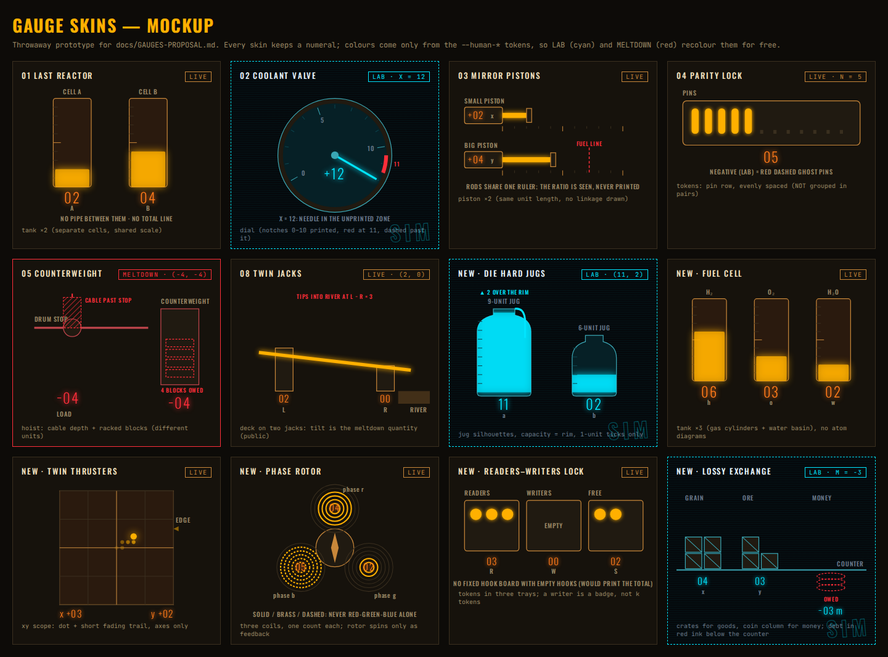

# Gauge skins: proposal

Status: **implemented (G0–G6, Oct 29)** for all 15 missions; see `LEVELS.md` "Display" lines for
what shipped per mission (13 is THE SLUICE TANKS, the jugs puzzle; Die Hard Jugs below) and
`ARCHITECTURE.md` "`display`" for the schema. The text below is the original proposal.

Original status: **proposal, nothing implemented.** Written 2026-10-29 while another agent was adding the
Deep Grid missions and renumbering the campaign, so this doc names missions by **title** first.
Current files: 07 TWIN JACKS, 08 THE AIRLOCK, 09 THE SPLITTER, 10 THE READING ROOM, 11 THE LOSSY
EXCHANGE, 12 THE FUEL CELL. Die Hard Jugs, Phase Rotor and Twin Thrusters had no JSON yet, so their
rows below are based on the owner's one-line description and must be checked when the levels land.

Mockups (throwaway HTML, not game code):

- `docs/screenshots/gauges-catalogue.png`: 12 skins at 1440 px, including lab (cyan) and meltdown
  (red) states and out-of-range values.
- `docs/screenshots/gauges-fuel-cell-mobile.png`: three tanks side by side at 390 px.



---

## 1. Audit of today's gauge

**Component.** `src/ui/machine/Gauge.tsx`, one per variable, rendered by `MachineView` inside
`.machine__gauges > .gauges` (a flex row that wraps, `flex: 1 1 9rem` per gauge).

| Aspect | Today |
|---|---|
| Props | `decl: VarDecl` (name, label, domain, init), `value: number`, `scale: number`. Nothing else: the gauge does not know the mode, the control that fired, or the history. |
| Domain | `nat`: bar fills from the left. `int`: bar centred on zero with a sign tube (`+`/`−`). Domain is the only per-variable display hint (PLAYTEST #14: PINS is `int`, so it shows a `+` tube although pins cannot be negative). |
| Digits | `abs(value)` padded to 2 digits; more digits just add tubes (no upper limit, the row grows). |
| Scale | One **shared** full scale for all gauges, `gaugeScale(max |value| over log + current state)` in `format.ts`, rounded to 10, 20, 50, 100, …; the bar clamps at 100%. Printed under the bar (`gauge-scale-*`, checked by `missions-smoke.mjs`). Shared scale is what makes Mission 01's "one goes down, the other goes up" visible today. |
| Layout | `machine.css` (`.gauges`, `.gauge`, `.tube`, `.gauge__bar`). Machine grid: gauges top-left, controls below, telemetry right; one column under 720 px. No per-level layout. |
| Animation | Digits re-key on change, so each new digit replays `tube-strike`; the bar animates `width/left` over `--dur-med`. There is no JS animation in the gauge. |
| Replay hooks | All verdict replays drive the gauges **only through the store**: `missionStore.show(state, mode)` and `replayFire(control)` set `state` and `display = { mode, firing, pulse }`. `MachineView` puts `data-mode` on `.machine`; `replay.css` restyles by mode. `ReplayStrip` (above the gauges) writes the mode title, the shown state and evaluates "Your Law" and "Meltdown" on it. |
| Lab "SIMULATION" | Pure CSS: inside `.machine[data-mode="lab"]` the `--human-*` tokens are overridden to hologram cyan, dashed border, scanline `::after`, and the `holo-mark` watermark. The gauge itself does nothing special. |
| Meltdown / init | Same trick: `data-mode="meltdown"` overrides `--human-nixie/primary/secondary` to alert red; `init` reddens tube borders; `live` with a false Law shakes the panel. |
| A11y | Tubes are `role="img"` with `aria-label="CELL A reads 2"`; bar and scale are `aria-hidden`. Gauges are not a live region; the Telemetry log is (`aria-live="polite"`), and `VerdictAnnouncer` speaks verdicts. |
| Reduced motion | Global rule in `global.css` shortens every transition/animation to 0.01 ms; `motion.ts` has `prefersReducedMotion()` for JS timings (used by the ENGAGE sequence). |
| Test hooks | `data-testid="gauge-<name>"` with `data-value` (read by `engage-smoke.mjs`, `screenshot-mission.mjs`), `gauge-scale-<name>`, `machine-gauges`. |

**Takeaway for the design:** because every mode effect is a CSS variable override on the panel, any
new skin that paints **only with `--human-*` tokens** gets lab cyan, meltdown red and the holds glow
for free, with zero mode logic. That is the main constraint the skins below are built around.

---

## 2. Design rules (apply to every skin)

1. **Never draw the Law.** A skin shows each variable in its own physical form. It never draws a
   derived quantity (sum, difference, ratio, weighted total, remainder) **unless that quantity is
   the meltdown's own** (public: it is printed on the meltdown placard). No "total" line, no ratio
   lever, no grouping by 2 or 3, no price tags turned into a value bar.
2. **Marks come only from public facts:** the meltdown placard, control guards, the briefing (a
   capacity, "eleven notches"). Every mark must be backed by one of those, and a test checks
   threshold marks against the meltdown expression (see §5).
3. **Uniform graduations.** One tick per unit (or per `scale/10`), never emphasised every 2nd or 3rd
   unit when parity or a multiple could be the answer.
4. **Motion only shows what a control does.** Animating "one core becomes two fragments" is fine;
   it is written on the control card already (`H −1, F +2`).
5. **Always keep a numeral.** Every skin carries a small nixie readout of the exact value. Pictures
   are for intuition, the number is the truth (and what telemetry, ARGUS and the banner quote).
6. **Render impossible states honestly.** The lab and INSUFFICIENT verdicts show states the machine
   never reaches. ℤ gauges can go negative (02, 03, 04, 05); any gauge can be huge (05 runaway,
   lab at `x = 12`); a phase or door can take a value with no label (Airlock `p = 2`). A skin must
   never clamp silently. Shared vocabulary:
   - **Below empty:** red hatched block under the floor (`▼ BELOW EMPTY`) or red dashed *ghost*
     items ("owed" blocks/coins/pins).
   - **Over scale / over capacity:** liquid over the rim, needle `PEGGED`, `+k MORE` badge, xy dot
     clamped to the frame edge with an arrow.
   - **No such position:** a selector pointer at an unlabelled `?` notch.
   The lab recolour already says "this is invented"; the skin's job is not to make the invented
   state look normal.
7. **Tokens only** (`--human-*`, `--meltdown`); no hard-coded colours in SVG. Three-way distinctions
   (rotor phases, trays) use shape or pattern as well as shade (colour-blind safe, and the lab
   recolour flattens hues anyway).

---

## 3. Skin catalogue

Cost: **S** about half a day for an agent (component + CSS + test), **M** about a day, **L** more.

### 3.1 `nixie` (today, the default)

```
CELL A           A
[0][2]
[████░░░░░░░░░]
0               10
```

- Data: anything. ℤ via sign tube and centred bar; unbounded via extra tubes and the shared scale.
- Modes: already handled by the CSS overrides.
- Cost: 0 (refactor into the skin interface only). Stays the fallback for every variable a level
  does not configure, so no mission ever breaks.

### 3.2 `tank` (and variant `jug`)

```
 CELL A    CELL B           9-UNIT JUG  ▲ 2 OVER THE RIM
 |    |    |    |            _/‾‾\_~
 |-   |    |-   |           |  ~~~ |
 |    |    |████|           |██████|
 |████|    |████|           |██████|
  02        04                11
```

Vertical column of liquid/charge on the **shared** scale (so two tanks compare at a glance, as the
bars do today), ticks per unit, optional red threshold line from the meltdown ("bursts at 5").
`jug`: same, but a bottle silhouette whose rim **is** a fixed `capacity` (Die Hard).

- Data: `nat` natural; `int` negatives as a hatched block below the floor; above scale/capacity:
  liquid over the rim plus label.
- Modes: free via tokens (cyan liquid in lab, red in meltdown).
- Cost: **S** (`tank`), **S** more for `jug` (an SVG path + clip).

### 3.3 `dial`

```
      5
   ·  |  ·  10
 0 ·  o----\  ▮ 11 (red)
```

Analogue needle over printed notches `[min, max]`, a red arc at the meltdown value, and a dashed,
unprinted zone beyond `max` so a lab value of 12 sits *past* anything the machine has.

- Data: bounded single variable; ℤ ok (min may be negative); beyond the arc → needle pegged +
  `PEGGED` label + numeral.
- Cost: **S**.

### 3.4 `piston` (linear rail)

```
SMALL PISTON  [+02 x]==|          FUEL LINE
BIG PISTON    [+04 y]====|           ¦ (7)
              ruler: | . . . . | . . . . |
```

Cylinder + rod; rod length = value × one unit length **shared by every piston of the level**, so a
coupling shows as rod lengths, without printing it. Optional red mark (meltdown position).

- Data: ℤ (negative = rod retracted past the head into a hatched zone); unbounded via the shared
  scale like today.
- Cost: **S**.

### 3.5 `tokens` (pins, blocks, crates, coins)

```
PINS   ▮ ▮ ▮ ▮ ▮ · · · · · · ·        +3 MORE
       05
```

One glyph per unit, evenly spaced, in a tray of `slots` (default 12) with `+k MORE` beyond. The
glyph is a parameter: `pin`, `block`, `crate`, `coin`, `token`, `badge`. Negative: red dashed ghost
glyphs ("owed"). Optional `cap` line from the meltdown (Lossy Exchange: the floor holds 4 B-crates).

- Data: small counts; ℤ via ghosts; large counts via the badge.
- Cost: **M** (glyph set, wrapping, `+k` logic, mobile width).

### 3.6 `selector` (discrete states)

```
  INNER ●     ○ OUTER     ? (p = 2)
```

A rotary switch or two lamps with named positions (`positions: { "0": "INNER OPEN", "1": "OUTER
OPEN" }`). Any other value lights an unlabelled `?` notch with the numeral.

- Data: small `nat`/`int` enumerations.
- Cost: **S**.

### 3.7 `scope` (2-D, two variables)

```
 +-----------+------+
 |           |    · |
 |           | · ●  |   x +03   y +02
 |-----------+------|
 |           |      |
 +-----------+------+
```

Phosphor dot at `(x, y)` with a **short** fading trail of the last N states from the telemetry log;
axes and coarse grid only. Out of frame: dot clamped to the edge with an arrow and the numerals.
In lab mode it draws only the invented `before → after` step (cyan ghost), never appended to the
real trail.

- Data: two ℤ variables, shared or per-axis scale.
- Cost: **M** (needs `history` from the log, and the lab/live trail rule).

### 3.8 Composite scenes (one-offs on top of the primitives)

These bind 2–3 variables into one physical picture. They cost more and are worth it only where the
scene **is** the mission.

| Scene | Picture | Vars | Cost |
|---|---|---|---|
| `deck` | plank resting on two jacks; tilt = left − right (the meltdown quantity), river on the tipping side | 2 | **M** |
| `hoist` | cable drum with a hook at depth `x` + a rack of `y` counterweight blocks (different units on purpose) | 2 | **M** |
| `rotor` | three coils around a rotor, each a ring counter for one phase; the rotor spins only as fire feedback | 3 | **M** |

**Considered and rejected** (spoilers, see §4): *communicating vessels* (implies equal levels and a
fixed total), *balance scale* (encodes the weights of a weighted sum), *hook board with a fixed
number of hooks* (prints a conserved total), *molecule diagrams* (atom counts = the weights).

---

## 4. Per-mission mapping

Spoiler risk: **none** (the picture adds nothing beyond the numbers), **low** (makes the pattern
easier to notice, like telemetry does), **medium** (a careless detail could state the answer;
mitigation listed), **high** (do not ship without the mitigation).

| Mission (current file) | Skin | Why it helps | Spoiler risk and mitigation | Lab/out-of-range |
|---|---|---|---|---|
| THE LAST REACTOR (01) | `tank` ×2, shared scale, "energy cell" styling | Charge visibly pours from one cell to the other; the player *sees* that what leaves A arrives in B. | **Low.** No pipe between the cells, no total line, no "6" mark. Communicating vessels rejected (would draw the conserved total). | `nat`, so only large values: liquid over rim. |
| COOLANT VALVE (02) | `dial`, notches 0–10 printed, red at 11, dashed past 11 | A valve *is* a handwheel/needle; the lab state `x = 12` lands visibly in a zone the valve does not have, which is exactly the lesson. | **Low.** Do not draw a mechanical *stop pin* at 10 (that is the answer); printed notches 0–10 are in the briefing. | 12 sits in the dashed zone; huge → `PEGGED`. Negative (ℤ): needle below 0 into a hatched zone. |
| MIRROR PISTONS (03) | `piston` ×2, one shared unit length, fuel line mark at 7 on the big rail | The big rod is visibly twice the small one at every step; ARGUS's lab state `(1, 0)` looks physically wrong (big rod not extended). | **Medium.** Briefing already says "twice as far". Never draw a 2:1 lever/linkage or a ratio readout. | `(0, −2)`: big rod retracted into the hatched zone. |
| PARITY LOCK (04) | `tokens` (`pin`), single evenly spaced row | Pins come and go two at a time; counting glyphs is more concrete than "n". Also fixes PLAYTEST #14 (no `+` tube for pins). | **High** if pins are drawn in pairs or with a lone "odd pin" slot: that states the Law. Mitigation: uniform spacing, no pair grouping, the insert animation drops two pins anywhere in the row. | `n = −2` (lab of `n ≠ 0`): two red ghost pins; never hide them. |
| THE COUNTERWEIGHT (05) | `hoist` scene (cable depth + racked blocks) | The two gauges become "load on the hook" and "weights on the rack"; ARGUS's `(0, 1)` (block racked, hook at the stop) looks like a mismatch. | **Medium.** Do not hang load and counterweight on one pulley at equal heights (that draws `x = y`). Use different units: cable length vs block count. | `(−10, −10)` (INSUFFICIENT): cable past the drum stop in red hatch, 10 owed ghost blocks. Runaway `LOWER`: hook leaves the frame → `+k` and numeral. |
| FINAL BREACH (06) | `tank` ×2 (capacitor banks), same as 01 | Continuity with 01; pulses of 2 visibly jump two ticks. | **Low**, provided ticks stay uniform (no emphasis on even levels) and no total line. | `nat`; large only. |
| TWIN JACKS (07) | `deck` scene: plank on two jacks, tilt toward the river, red "tips at L − R = 3" | The meltdown is a tilt; the cross-feed visibly flips the deck, which is the lab lesson (the other side matters). | **Medium.** The tilt is the meltdown quantity, so public. Do **not** draw a symmetric ±2 tolerance band; mark only the river-side tipping point. | `(0, 3)` lab: deck steeply tilted the other way; clamp angle at ±max and show both numerals. |
| THE AIRLOCK (08) | `selector` for door phase (INNER / OUTER) + `tank` for chamber air, `FULL` mark at 4 | Phase and air sit next to each other as door + chamber, so "this door with that air" reads physically. | **Medium.** No labels like "phase 0 ⇒ 4". `FULL = 4` comes from the briefing. | `p = 2` → `?` notch; `(0, 8)` → air over the `FULL` mark (scale grows), not clamped. |
| THE SPLITTER (09) | `tokens`: cores in a core rack, fragments in a chamber with a red line at 7 | Cores and fragments become countable objects; SPLIT animates one core into two fragments (the control's effect). | **High** if a core glyph is drawn as two fused fragments or the chamber shows "mass": that is the weighting. Mitigation: unrelated glyph shapes, same visual size; no balance scale. | `nat`; `(1, 5)` lab is ordinary. Large → `+k MORE`. |
| THE READING ROOM (10, readers–writers) | `tokens` in three trays: readers, writers (as `badge`), free tokens | People and brass tokens are objects; the guards ("needs all three") read off the free tray. | **High** if a writer is drawn holding three tokens or the vault shows a three-hook board with empty hooks: either makes the weighted total a fixed visible count. Mitigation: writer = badge glyph; tokens consumed by WRITE IN vanish from the free tray (the card says `S −3`). | `nat`; lab states like `(1, 1, 0)` are just two trays occupied, the meltdown red does the rest. |
| THE LOSSY EXCHANGE (11) | `tokens`: A-crates, B-crates (floor with 4 slots + red 5th), chits as a coin column | Buying/selling is moving crates and coins; the skim is visible as fewer coins coming back. | **Medium-high.** No price tags on crates and no "portfolio value" bar (that is the weighted sum). Prices stay on the control cards. | `nat`; large chit counts → coin column `+k`. (Mockup shows a negative "owed" column only to demo ghosts; `m` is ℕ.) |
| THE FUEL CELL (12) | `tank` ×3 (H₂, O₂ cylinders with burst lines at 5 and 3, water basin), shared scale | Burns visibly drain both gases into water; the hydrogen column standing at twice the oxygen column becomes visible without being stated. | **Medium.** No molecule art (H–H, O=O, H–O–H) and no atom counters: those are the weights. Shared scale is fine (same as 01). | `nat`; above the burst line is the meltdown and draws in red. |
| DIE HARD JUGS (new, 9 and 6) | `jug` ×2, rims at 9 and 6, one-unit ticks | The whole puzzle is pouring between jugs; seeing fill levels and rims makes "fill / empty / pour until full" obvious. | **High** if ticks are emphasised every 3 units or levels snap to thirds (the likely hidden fact is about multiples). Mitigation: uniform one-unit ticks, no labelled marks except the rim. | Lab above capacity → water over the rim with `▲ k OVER THE RIM` (mockup). |
| PHASE ROTOR (new, r/g/b) | `rotor` scene: three coils, ring counters per phase | Three counts around a rotor read as one machine; firing a control spins the rotor briefly. | **High** if the rotor *angle* is computed from the counts (e.g. a weighted sum mod 3): that is a cyclic invariant drawn. Mitigation: angle is pure feedback (fixed spin per fire), never a function of state. Phases distinguished by pattern, not red/green/blue. | Large counts → ring full + `+k`; ℤ negatives (if any) → ghost rings. |
| TWIN THRUSTERS (new, x/y) | `scope` with a 6-step fading trail | Two numbers become a position; a trajectory is far easier to read than two columns of telemetry. | **Medium-high.** A long trail draws the reachable set (a line or lattice = the Law). Mitigation: short trail, axes and 5-unit grid only, no diagonal guides. | Off-frame → clamped dot + arrow + numerals; lab draws only the invented step in cyan. |

Not every mission must change: if a skin adds no physical meaning, `nixie` stays (it is also the
safe fallback for a level whose JSON has no `display`).

---

## 5. Architecture

### 5.1 Level JSON: optional `display`

Composite skins span several variables, so the config is a list of **panels** at the top level,
not a field per variable:

```json
"display": {
  "panels": [
    { "skin": "tank", "vars": ["a", "b", "c"], "marks": { "a": [{ "at": 5, "label": "BURST" }], "b": [{ "at": 3, "label": "BURST" }] } }
  ]
}
```

```json
"display": { "panels": [ { "skin": "scope", "vars": ["x", "y"], "trail": 6 } ] }
"display": { "panels": [ { "skin": "jug", "vars": ["a", "b"], "capacity": { "a": 9, "b": 6 } } ] }
"display": { "panels": [ { "skin": "selector", "vars": ["p"], "positions": { "0": "INNER OPEN", "1": "OUTER OPEN" } },
                         { "skin": "tank", "vars": ["a"], "marks": { "a": [{ "at": 4, "label": "FULL" }] } } ] }
```

- Optional; absent → one `nixie` panel per variable (today's behaviour, pixel-identical).
- zod: a discriminated union on `skin` in `level.ts` (pure data, no DOM, so engine purity holds).
  `strictObject` today rejects unknown keys, so the schema change is required. Static validation:
  every variable appears in **exactly one** panel; per-skin arity (`scope` = 2, `deck` = 2,
  `rotor` = 3); marks reference panel variables. Unknown/missing → load error, as for other fields.
- `Level` gets `display: DisplaySpec` (filled with the default when absent). The verifier ignores it.

### 5.2 Component interface

```ts
// src/ui/machine/skins/types.ts
interface SkinProps<P> {
  vars: VarDecl[];            // the panel's variables, in panel order
  values: number[];           // current state, same order
  scale: number;              // shared full scale (gaugeScale), skins may ignore it (jug capacity)
  mode: DisplayMode | null;   // live | lab | meltdown | init | holds | null (free play)
  firing: string | null;      // control just fired (for feedback such as the rotor spin)
  pulse: number;              // re-key for one-shot feedback animations
  history: State[];           // telemetry states, for `scope` only (live log, never lab states)
  params: P;                  // the panel's JSON params, already validated
}
type GaugeSkin<P> = (props: SkinProps<P>) => JSX.Element;
```

- `skins/registry.ts` maps `skin` → component; `MachineView` maps `level.display.panels` to
  `<GaugePanel>` instead of mapping `level.vars` to `<Gauge>`. `Gauge.tsx` becomes `NixieSkin`.
- Shared pieces: `<Numeral value domain />` (the nixie readout of rule 5), `<OutOfRange />` glyphs,
  the hatch/ghost SVG `<defs>` once per panel.
- Pure geometry in `skins/geometry.ts` (`fillFraction(value, scale) → { frac, over, under }`,
  `needleAngle`, `clampToFrame`, `trailOpacity`) so it is unit-tested without React.

### 5.3 Contracts every skin keeps

- One `role="img"` element per variable with `data-testid="gauge-<name>"`, `data-value`, and the
  same `aria-label` as today (`"CELL A reads 2"`), plus out-of-range words when relevant
  (`"WATER reads 11, over capacity 9"`, `"PINS reads −2, below empty"`). Smoke scripts keep working.
- `gauge-scale-<name>` only where a printed scale exists (`missions-smoke` iterates over what it
  finds, so its regex check remains valid).
- Colours only from tokens → lab/meltdown/holds styling stays in `replay.css`, no skin knows modes
  except `scope` (lab ghost step) and feedback-only spins.
- Motion: CSS transitions on `transform`/`height`/`opacity` with `--dur-med`; no JS timers, so the
  global reduced-motion rule covers everything. Feedback spins/fly-ins are decoration: under reduced
  motion the end state appears at once.

### 5.4 Replay and lab

Nothing changes in the stores: `show` and `replayFire` already update `state` and `display`; the
skins re-render and their CSS transitions *are* the replay. `scope` needs one rule: in `lab` and
`meltdown` modes it draws the shown state (and, after `replayFire`, a `before → after` arrow from
the previous shown state) in the overridden colour, and does not mix it into the live trail.

### 5.5 Tests

- `tests/display.test.ts`: schema (defaults, exactly-once coverage, arity, bad params), and a
  **marks vs meltdown** check: for each single-variable threshold mark labelled as meltdown/burst,
  `evalBool(meltdown, …)` flips at the mark (keeps rule 2 honest).
- `tests/skinGeometry.test.ts`: fractions, over/under flags, clamp-to-edge, ticks are uniform (no
  emphasis interval that divides a level's modulus, a cheap guard for rule 3).
- Component smoke (RTL): each skin renders its `gauge-<name>` with `data-value` and the label, for a
  normal, a negative (ℤ) and a huge value.
- Playwright: extend `missions-smoke` / `a11y-smoke` with: every mission at 390 px has no
  horizontal overflow (3-variable missions included), and a screenshot per skin in lab mode
  (`gauges-<mission>-lab.png`).
- Spoiler review is human: add a "Display" line per mission in `LEVELS.md` with the risk note from
  §4, and a checklist item to the authoring checklist ("the display draws no derived quantity
  except the meltdown's").

### 5.6 Phased plan (coding-agent sized tasks)

Start after the parallel mission/3-variable layout work has landed; G0 touches the same files.

| Task | Scope | Done when |
|---|---|---|
| **G0** Infrastructure | `display` schema + default, `GaugePanel`, registry, `Gauge` → `NixieSkin`, `Numeral`, geometry module, tests | All missions pixel-identical (screenshots), lint/typecheck/test/build green |
| **G1** `tank` + `jug` | skins, marks, over/under rendering; config for LAST REACTOR, FINAL BREACH, FUEL CELL; Die Hard once its JSON exists | Mockup look in game, lab/meltdown recolour verified, 390 px ok |
| **G2** `piston` + `dial` | MIRROR PISTONS, COOLANT VALVE | `(0, −2)` and `x = 12` render honestly |
| **G3** `scope` | TWIN THRUSTERS (history, lab ghost step, edge clamp) | trail rule tested; off-frame state readable |
| **G4** `tokens` + `selector` | PARITY LOCK, THE SPLITTER, READING ROOM, LOSSY EXCHANGE, AIRLOCK | spoiler notes in §4 respected, reviewed by owner |
| **G5** scenes | `deck` (TWIN JACKS), `hoist` (COUNTERWEIGHT), `rotor` (PHASE ROTOR) | one scene per task |
| **G6** Docs + polish | DESIGN.md §8 paragraph, LEVELS.md display lines, screenshots | owner playtest |

**Recommendation: do G0 + G1 + G2 (pistons) + G3 first**, i.e. these four missions:

1. **THE LAST REACTOR** (tank): the first mission and the tutorial screens; the first impression
   of the game becomes "a machine", and the conservation is felt, not printed.
2. **DIE HARD JUGS** (jug): the puzzle *is* jugs; numbers alone hide it. Cheap once `tank` exists
   (THE FUEL CELL comes for free with the same skin).
3. **MIRROR PISTONS** (piston): a relation between two numbers becomes two rods on one ruler; the
   biggest "aha" per line of code.
4. **TWIN THRUSTERS** (scope): two coordinates as numbers are the hardest thing in the game to read;
   a dot on a scope is instant.

---

## 6. Risks

- **Spoilers.** The main risk; mitigated by the rules in §2 and the per-mission notes in §4, but it
  needs an owner review of each mission before shipping. When in doubt, ship `nixie`.
- **Mobile width with 3 variables.** Three tanks fit at 390 px (`gauges-fuel-cell-mobile.png`,
  ~54 px per column, no overflow). Token trays with many glyphs and the 3-coil rotor are the tight
  ones: cap tray slots (`+k MORE`) and give the rotor a min-size of ~260 px. The parallel 3-variable
  layout work should be reused, not duplicated.
- **Reading exact values.** Pictures are imprecise; the numeral (rule 5) keeps exact reading, and
  ARGUS/telemetry/banner already quote numbers.
- **Style consistency.** Skins risk looking like a different game. Keep: brass outlines
  (`--human-secondary`), amber glow (`--human-primary` drop-shadow), Oswald labels, nixie numerals,
  no gradients beyond the existing glass/tube treatment. The mockup follows this and the lab/
  meltdown recolour works unchanged on all of it.
- **Performance.** Inline SVG with < 100 nodes per panel, re-rendered at most every 750 ms (auto-run)
  or per replay step: negligible. Avoid SVG filters on many nodes (drop-shadow on each token);
  prefer one filter on the group.
- **A11y.** Keep one labelled `role="img"` per variable, with out-of-range words; never convey
  state by colour alone (lab/meltdown already have text in `ReplayStrip`); patterns for phases.
  axe runs in `a11y-smoke`.
- **Honesty of lab states.** If a skin clamps or hides a value, ARGUS's counterexample becomes
  unreadable and the player stops trusting the machine. The `geometry` tests and the per-skin
  negative/huge smoke cases are the guard.
- **Scope/time.** Deadline 2026-11-30. G0–G3 is roughly 3–4 agent days; G4–G5 are optional polish
  and can go to the Stretch section of `ROADMAP.md` if time is short.
